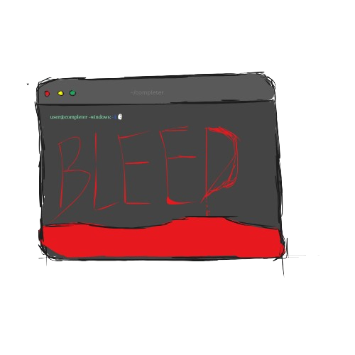

#  COMPLETER

>_a browser based git "log" replica but hollup somethings wrong w it._
<br/>


<br>
<br>

## what ts is

youre an investigator basically reviewing a "git log" for a project called "completer" -  which was supposed to be a simple task automation tool, except the commits are wrong, the timestamps are also wrong and even the author is wrong

so its basically an experience where u can try to hassle but its basically pointless

## how ts was built

and for this, ive used [SvelteKit](https://svelte.dev/) WHICH WAS OH GOD I SWEAR EQUIVALENT OF HELL i struggled so much adapting to the syntax [Typescript](https://www.typescriptlang.org/) for all the reactive states, UI, and etc except the ambient music loop, and again as always, Tailwind CSS for the atmosphere and the style. so basically zero runtime dependencies besides Svelte itself :D

## how ts works

- git log - ts the main screen and commits load in one by one soyou click any commit with a note to expand it and dont try to hover over the red one.

- terminal - type commands at the bottom input, (ask for "help") for detailed command options and yes u can fidget w them

- idle state - if you stop interatcting the terminal starts tweaking (u gotta try dat:D)

## running ts locally

you'll NEED [Node.js](https://nodejs.org/en)

```
npm install
npm run dev
```

then you can just open the localhost link with the port 5173 and yay thats your entire setup.

**things worth knowing while testing:**
 - the radio is using WebSpeech API and specifically looks for "Google UK English Male" / "David" and if neither is available on your sytem the ghost will still reply just visually js without the voice.
 - seal logic requires the ghost to be weakened (8s window after the radio reply) AND in the same room as you, AND YOU NEED TO click the anchor hotspot.

## assets

i made the logo by myself in Canva and the ambient music idont even remember where igot it from :(


headphones are recommended btw.
